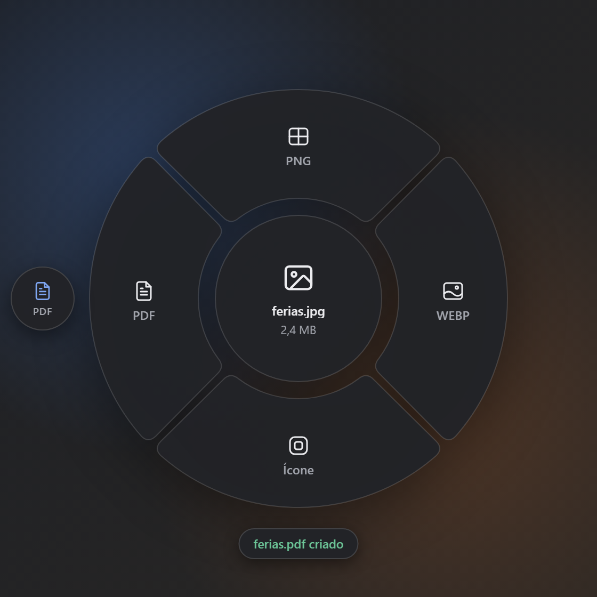

<div align="center">


# Órbita

**Converta arquivos direto do Explorer, num menu radial.**
Clique com o botão direito num PDF ou numa imagem, escolha o formato e pronto:
o arquivo novo aparece ao lado do original.

Leve · rápido · 100% local · código aberto (MIT)




</div>

---

## O que ele faz

| Arquivo | Converte para |
|---|---|
| **PDF** | PNG · JPG (uma imagem por página) · Texto (TXT) · Comprimir |
| **Vários PDFs** | Juntar em um PDF só |
| **Imagens** (PNG, JPG, WEBP, BMP) | PNG · JPG · WEBP · Ícone (ICO) · PDF |
| **Várias imagens** | Juntar em um PDF (uma imagem por página) |
| **PDFs + imagens juntos** | Juntar em um PDF |

- **Nunca altera o original.** Se já existir um arquivo com o mesmo nome, o novo ganha `(1)`, `(2)`…
- **Encadeie conversões:** depois de converter, o arquivo novo aparece ao lado do menu.
  Clique nele para converter de novo, por exemplo `foto.jpg → PDF → Comprimir`.
- **Tudo local.** Nenhum arquivo sai do seu computador e o Órbita não usa internet.

## Instalar

### Windows 10 e 11

**Pelo terminal (PowerShell):**

```powershell
irm https://raw.githubusercontent.com/Richard-Vieira/orbita/main/scripts/install.ps1 | iex
```

O script baixa a última versão, confere o SHA-256 e instala só para o seu usuário (não pede administrador).

**Ou baixe o instalador:** vá em [Releases](https://github.com/Richard-Vieira/orbita/releases/latest),
baixe o `Orbita_..._x64-setup.exe` e abra.

> **"O Windows protegeu o computador"?** Clique em **Mais informações → Executar assim mesmo**.
> O aviso aparece porque o instalador ainda não tem uma assinatura digital paga. Todo o código está
> aqui no repositório e cada versão publica o SHA-256 do instalador (`SHA256SUMS.txt`).

O instalador tem cerca de **5 MB**. O Órbita inicia com o Windows e fica na bandeja do sistema.

### Linux

Em desenvolvimento. O projeto já está organizado para isso: o núcleo de conversões é o mesmo
e só a integração com o sistema muda (veja [Estrutura](#estrutura-do-projeto)). A ideia é
acionar o Órbita pelo menu do gerenciador de arquivos (Nautilus, Dolphin, Nemo, Thunar).

## Como usar

1. **Botão direito** num arquivo → **Converter com Órbita**
   (no Windows 11, fica em **Mostrar mais opções**; use o atalho abaixo para ir mais rápido).
2. Ou selecione o arquivo no Explorer ou na área de trabalho e aperte **Ctrl + Alt + Espaço**.
3. Clique numa fatia. O progresso aparece na própria fatia e, ao terminar, uma notificação
   discreta mostra o arquivo criado, com o botão **Abrir pasta**.
4. **Esc** ou um clique fora fecha o menu.


Pelo ícone na bandeja dá para desligar a opção **Iniciar com o Windows** ou sair do Órbita.

### Detalhes de cada conversão

- **PDF → PNG/JPG:** 200 dpi (texto pequeno continua nítido). Um PDF de várias páginas vira
  uma pasta `arquivo (PNG)` com `página 01.png`, `página 02.png`…
- **PDF → Texto:** junta palavras hifenizadas no fim da linha. PDFs digitalizados (só imagem)
  não têm texto; o Órbita avisa em vez de criar um arquivo vazio.
- **Comprimir PDF:** reduz imagens acima de 200 dpi para 150 dpi e reorganiza a estrutura do
  arquivo. Funciona muito bem em PDFs escaneados ou com fotos (−50% a −80%) e pouco em PDFs só
  de texto (−10% a −20%). O resultado é conferido antes de ser salvo e, se não ficar pelo menos
  10% menor, o Órbita avisa que o PDF já está otimizado.
- **Juntar PDFs:** em ordem alfabética. Formulários deixam de ser editáveis e marcadores
  (índice) não são mantidos; o Órbita avisa quando isso acontece.
- **Imagens:** respeita a rotação das fotos de celular e o perfil de cor; transparência vira
  fundo branco no JPG; o ícone `.ico` sai com 7 tamanhos (16 a 256 px).
- **Imagem → PDF:** JPGs entram no PDF sem perder qualidade (sem recompressão).

## Desinstalar

**Configurações → Aplicativos → Órbita → Desinstalar.** O desinstalador remove tudo, inclusive
o item do menu do botão direito e o início automático.

## Desempenho

Medido num PC comum com Windows 10:

| | |
|---|---|
| Memória em segundo plano | ~2–6 MB |
| Abrir o menu | ~0,4 s na primeira vez, depois ~15 ms |
| PDF de 15 páginas → PNG | ~3 s |
| Comprimir PDF escaneado de 4 MB | ~1,4 s (ficou com 0,8 MB) |
| Juntar 3 PDFs (29 páginas) | ~0,5 s |
| Converter uma imagem | menos de 1 s |

Depois de 10 minutos sem uso, o Órbita libera a interface e volta ao consumo mínimo.

## Desenvolvimento

Requisitos: [Rust](https://rustup.rs) (com as *Build Tools* do Visual Studio no Windows) e
[Node.js](https://nodejs.org) 20+.

```powershell
git clone https://github.com/Richard-Vieira/orbita
cd orbita
./scripts/fetch-pdfium.ps1     # baixa o pdfium numa versão fixa (Linux: sh scripts/fetch-pdfium.sh)
npm install
npm run tauri dev              # roda o app em modo de desenvolvimento
npm run tauri build            # gera o instalador em target/release/bundle/nsis
cargo test --workspace         # testes (geram os próprios arquivos de teste)
```

A interface também roda no navegador comum, com dados de demonstração: `npm run dev` e abra
`http://localhost:1420/?demo=pdf` (ou `?demo=image&theme=dark`).

Para testar uma conversão sem interface:

```powershell
cargo run -p orbita-cli -- acoes arquivo.pdf
cargo run -p orbita-cli -- converter pdf.compress arquivo.pdf
```

### Publicar uma versão

Atualize a versão em `src-tauri/tauri.conf.json`, `Cargo.toml` e `package.json` e crie a tag:

```powershell
git tag v0.2.0
git push origin v0.2.0
```

O GitHub Actions gera o instalador e publica em Releases.

### Estrutura do projeto

```
orbita/
├─ crates/
│  ├─ orbita-core/       conversões (sem interface e sem código de sistema operacional)
│  │  └─ src/converters/ um arquivo por conversão
│  ├─ orbita-platform/   integração com o sistema: windows/ hoje, linux/ depois
│  └─ orbita-cli/        linha de comando (testes, CI e futuras integrações no Linux)
├─ src-tauri/            app: janelas, bandeja, atalho, fila de conversões, instalador
├─ ui/                   menu radial e notificação (TypeScript, sem framework)
├─ scripts/              pdfium com versão fixa e instalação pelo terminal
└─ .github/workflows/    testes a cada push e release ao criar tag
```

### Como adicionar um formato

1. Crie um arquivo em `crates/orbita-core/src/converters/` implementando o trait `Converter`
   (veja `pdf_text.rs`, o exemplo mais simples).
2. Registre-o na função `all()` de `converters/mod.rs`.
3. Se for um formato de entrada novo, inclua a extensão em `format.rs`. O item do menu do
   botão direito passa a aparecer para ela automaticamente.
4. Se precisar de um ícone novo, adicione-o em `ui/src/icons.ts`.

DOCX e HTML → PDF estão previstos na arquitetura, mas ficaram fora desta versão: não há hoje
uma forma ao mesmo tempo leve e confiável de convertê-los sem depender de programas grandes
(como LibreOffice ou Word).

## Limitações conhecidas

- No **Windows 11**, o item aparece em "Mostrar mais opções". Colocá-lo no menu principal
  exige um pacote com assinatura digital paga.
- Sem assinatura digital, o Windows mostra o aviso do SmartScreen na instalação. Em alguns
  PCs com o **Controle Inteligente de Aplicativos** ligado, a instalação pode ser bloqueada.
- PDFs protegidos por senha não são convertidos (o Órbita avisa).
- Não há OCR: PDFs digitalizados não viram texto.

## Licença

[MIT](LICENSE). Componentes de terceiros (PDFium, libwebp e outros) estão listados em
[THIRD_PARTY_NOTICES.md](THIRD_PARTY_NOTICES.md).
